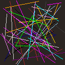
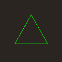

## Kiwi Game Engine Project

Este projeto busca criar uma game engine totalmente do zero utilizando somente a linguagem C.<br>
-- *Inspirada no lendário projeto Handmade Hero*

<span style="color:red">**Disclaimer:**</span> Futuramente irei mudar a API gráfica para uma stack baseada em **OpenGL + SL3**.<br>
Porém isto será feito somente quando a engine estiver madura o suficiente.




*Saída atual: retângulos aninhados, cada um desenhado numa view do bitmap anterior (renderização 100% em software, exportada como `.ppm`).*

---

### Sobre o projeto

A Kiwi é antes de tudo uma **jornada de aprendizado**: o objetivo é entender, implementando à mão, cada camada de uma game engine, da escrita de pixels na memória até a renderização acelerada por GPU.

Princípios:

- **C puro, sem dependências** além da biblioteca padrão e das APIs do sistema operacional.
- **Renderização em software primeiro.** Os algoritmos clássicos de rasterização são implementados seguindo o livro *Computer Graphics: Principles and Practice* (Foley et al., 2ª ed. em C), antes da migração para GPU.
- **Camada de plataforma isolada.** O código dependente de SO (Linux/X11 e Windows/Win32) fica separado do código da engine.

### Estado atual

- **Bitmaps** (`draw.c`): um `Bitmap` é uma *view* sobre um buffer de pixels `uint32_t` (`pixels`, `width`, `height`, `stride`). Sub-regiões são views sem cópia, inclusive views de views.
- **Primitivas**: `draw_pixel` e `fill_rect`.
- **Imagens PPM** (`image.c`): leitura e escrita de arquivos `.ppm` (P6, 8 bits), usados para visualizar a saída do renderizador.

### Compilando e executando

```bash
bash build.sh                 # gera bin/draw.out
./bin/draw.out saida.ppm      # renderiza e salva a imagem
```

Para visualizar o `.ppm`, use um visualizador que suporte o formato (ex.: GIMP, `feh`, `eog`) ou converta para PNG.

### Roadmap

1. **Bitmap e primitivas sólidas**: `clear`, `draw_pixel`, `fill_rect` com clipping nas bordas.
2. **Linhas, círculos e sprites**: Bresenham / ponto médio, blit de sub-regiões com alpha blending.
3. **Câmera 2D e transformações**: posição, zoom e rotação aplicadas antes do desenho.
4. **Camada de plataforma**: janela, input e game loop (X11 e Win32).
5. **Rasterização 3D em software**: projeção, z-buffer, shading, texturas.
6. **Migração para GPU** (OpenGL).

### Referências

As principais referências de estudo do projeto estão em [`refs.md`](refs.md).
